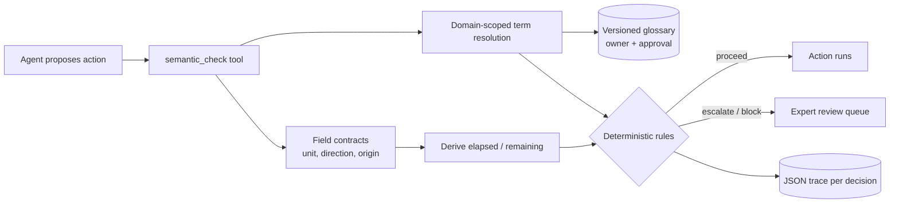

# Semantic Engineering Layer

**Knowing a word is not knowing its meaning.** This repo is a deterministic layer an AI agent calls *before it acts*, so that domain words are read the way an expert reads them.

## Recruiter summary
- **Problem:** general-purpose models read industry words with everyday meaning. "Positive crossmatch" sounds like good news but means an incompatible transplant pairing; "14 hours cold ischemia" is time already *used*, not time left.
- **Approach:** an expert-owned, versioned glossary, domain-scoped term resolution, field contracts that compute elapsed vs remaining, deterministic critical rules, and an expert-review queue, exposed as an MCP-style tool.
- **Proof (measured, synthetic data):** across 4 domains, a naive keyword reader let unsafe actions proceed 20 times out of 30 cases; the semantic layer let 0 proceed. See the table below.

## Results (measured on synthetic cases)
<!-- RESULTS:START -->
Measured on 30 synthetic cases (regression checks, not quality claims). Tests: 58 collected, 58 passed.

| Domain | n | Baseline acc | Semantic acc | Baseline critical recall | Semantic critical recall | Baseline unsafe proceeds | Semantic unsafe proceeds |
|---|---|---|---|---|---|---|---|
| insurance_claims | 7 | 0.0 | 1.0 | 0.0 | 1.0 | 4 | 0 |
| medical_logistics | 9 | 0.111 | 1.0 | 0.0 | 1.0 | 7 | 0 |
| mortgage_lending | 7 | 0.286 | 1.0 | 0.0 | 1.0 | 5 | 0 |
| retail_supply_chain | 7 | 0.286 | 1.0 | 0.0 | 1.0 | 4 | 0 |
| overall | 30 | 0.167 | 1.0 | 0.0 | 1.0 | 20 | 0 |
<!-- RESULTS:END -->

"Unsafe proceed" = the case should have been blocked or escalated but the system said proceed. Expected labels were written by the repo author alongside the rules, so 1.0 here is a regression check, not a generalisation claim (see [limitations](docs/limitations.md)).

## Architecture


## How it works
1. **Glossary** (`data/glossary.json`): each term has an id, domain, expert definition, synonyms and abbreviations, signal, owner, `approved`/`draft` status and version. Draft terms never drive an automatic decision.
2. **Normalization** (`glossary.py`): matching is scoped to the case's domain, longest synonym first, so `cold chain excursion` wins over `cold`, and `positive` only means something inside a known phrase.
3. **Field contracts** (`data/field_contracts.json`, `contracts.py`): definition, direction (elapsed vs remaining), unit, limit, origin system. Inputs in minutes/hours/days or as start/now timestamps are converted and both elapsed and remaining are computed. If a source reports the opposite direction from the contract, the value is converted *and* escalated for confirmation.
4. **Rules** (`engine.py`): critical terms block, review terms or near-limit fields escalate, expired fields block, unknown fields or no recognised terms escalate ("refuse to guess"). Strictest outcome wins.
5. **Trace**: every decision records matched synonyms, term ids and versions, derived values and the glossary version (`results/traces.jsonl`).
6. **Tool** (`tool.py`): JSON-schema'd `semantic_check` with extra-key rejection; `guarded_agent_step` can only make an agent's action safer, never riskier.

## Real code and output
```python
from semantic_layer.contracts import derive, load_contracts
derive(load_contracts()["cold_ischemia_elapsed"], {"value": 14, "unit": "h"})
```
```
{'field': 'cold_ischemia_elapsed', 'unit': 'h', 'elapsed': 14.0, 'remaining': 10.0, 'limit': 24, 'state': 'ok', ...}
```
`python examples/agent_tool_demo.py` (real output):
```
{"proposed": "book ground courier", "result": "BLOCK: book ground courier withheld"}
{"proposed": "book ground courier", "result": "book ground courier"}
{"proposed": "release payment", "result": "BLOCK: release payment withheld"}
{"proposed": "ship pallet", "result": "ship pallet"}
```

## How to run (offline, no API keys)
```bash
python -m venv .venv && . .venv/bin/activate && pip install -r requirements-dev.txt
python scripts/count_tests.py           # prints TOTAL_TESTS=
PYTHONPATH=src python -m semantic_layer.compare
python examples/agent_tool_demo.py
python scripts/render_readme.py          # refresh the results block
```

## Guardrails
Fail-closed on unknown terms, fields, domains and units; draft definitions cannot auto-approve; direction mismatches escalate; tool input schema rejects extra keys and oversized text; synthetic data only; brand-name hash check and gitleaks in CI. Details: [docs/guardrails.md](docs/guardrails.md).

## Built vs planned
| Item | Status |
|---|---|
| Glossary, normalization, field contracts, rules, review queue, traces | Built |
| Baseline vs semantic comparison CLI, 4 domains, 30 synthetic cases | Built |
| MCP-style tool function + agent demo | Built (in-process, no MCP server) |
| Negation / typo handling | Planned (known limits, kept as tests) |
| Real MCP server transport, glossary approval UI | Planned |

## Docs
[How it works](docs/how-it-works.md) · [Guardrails](docs/guardrails.md) · [Limitations](docs/limitations.md) · [Implementation guide](docs/implementation-guide.md) · [Checklist](docs/semantic-engineering-checklist.md) · [Training labs + capstone](docs/training.md) · [Threat model](docs/threat-model.md) · [ADRs](docs/adr/) · [Interview points](docs/interview-points.md)

## Related repos
Jagadish-agent-failure-engineering-lab (loop control and evaluation failures), Jagadish-ai-gateway-control-plane (policy gateway), Jagadish-permission-aware-rag (grounding), Jagadish-agentic-data-layer (data contracts).

All organisations named in data (e.g. Northwind Transplant Center, Fabrikam Mutual, Contoso Grocers) are fictional. Limits are illustrative lab values, not clinical, actuarial or lending guidance.
